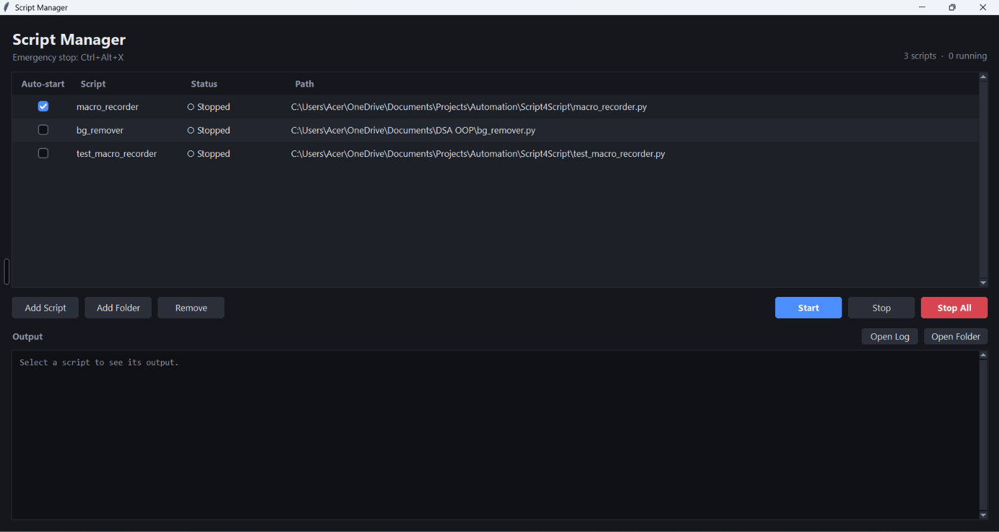

# Script Manager

A small desktop app (Python + tkinter) to add, start, stop and monitor my own automation scripts from one window.



## Features

- **One list for all scripts**: add a single script, or a whole folder at once.
- **Start / Restart / Stop / Stop All**, with a live status for each script (running, stopped, finished, crashed) and how long a running script has been up.
- **Live output**: select a script to see what it prints, with errors shown in red. Output is also saved to `logs/<script name>.log`.
- **Auto-start**: tick the box next to a script and it starts whenever the manager opens. Unticked by default, so nothing runs without your say-so.
- **Emergency stop**: press `Ctrl+Alt+X` from anywhere to stop every script.
- **Open Log / Open Folder** buttons for the selected script.
- Dark theme, high-DPI aware, long paths scroll sideways.

## Requirements

- Python 3.8 or newer (tkinter comes with the standard Windows installer).
- Only Python scripts can be added: files ending in `.py` or `.pyw`. Anything else is ignored by Add Folder and hidden by default in the Add Script file picker.
- Optional: `pip install keyboard` for the emergency-stop hotkey. Without it everything else still works and the header says the hotkey is unavailable. (On Linux the `keyboard` library needs root.)

## Run it

Double-click `script_manager.pyw`, or:

```
python script_manager.pyw
```

The `.pyw` extension means no console window opens. If the window ever fails to appear, look in `logs/_manager_crash.log`.

## How to use

| Do this | To get this |
| --- | --- |
| **Add Script** | Pick one `.py` / `.pyw` file |
| **Add Folder** | Add every `.py` / `.pyw` directly inside a folder (skips subfolders, files starting with `_`, and duplicates) |
| Click a row | See its output below |
| Click the box in **Auto-start** | Start that script every time the manager opens |
| **Start** / **Stop** | Run or stop the selected script |
| **Restart** | Stop the selected script and start it again fresh (log and running time reset) |
| **Stop All** or `Ctrl+Alt+X` | Stop everything |
| **Open Log** / **Open Folder** | Open the selected script's log file or its folder |
| **Remove** | Take it out of the list (the file itself is not touched) |

The hotkey can be changed with `EMERGENCY_HOTKEY` at the top of `script_manager.pyw`.

## Files it creates

| File | What it is |
| --- | --- |
| `scripts.json` | Your script list and auto-start choices (not committed to git) |
| `logs/` | One log per script, plus `_manager_crash.log` if the manager itself crashes (not committed to git) |

Everything except the optional hotkey uses only Python's standard library.

## Known limits

- Two scripts with the same file name in different folders share one log file.
- A script's log is wiped each time you press Start.
- Closing the manager stops all running scripts.
